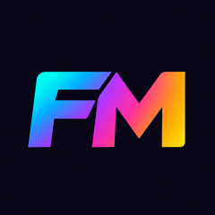
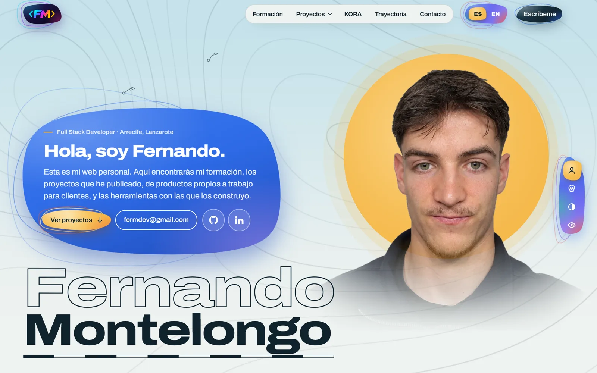
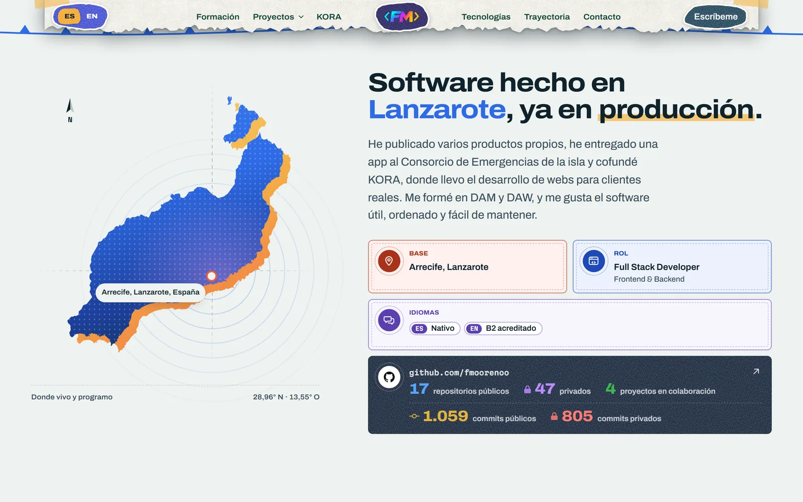
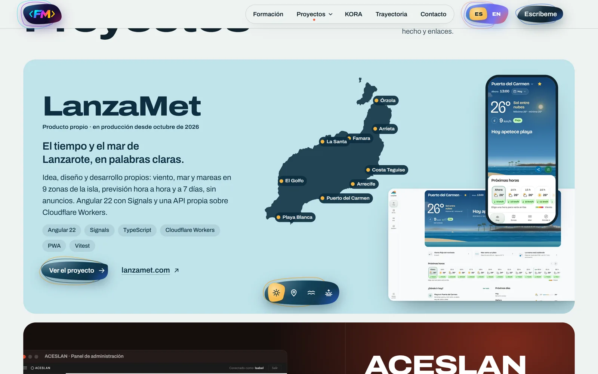
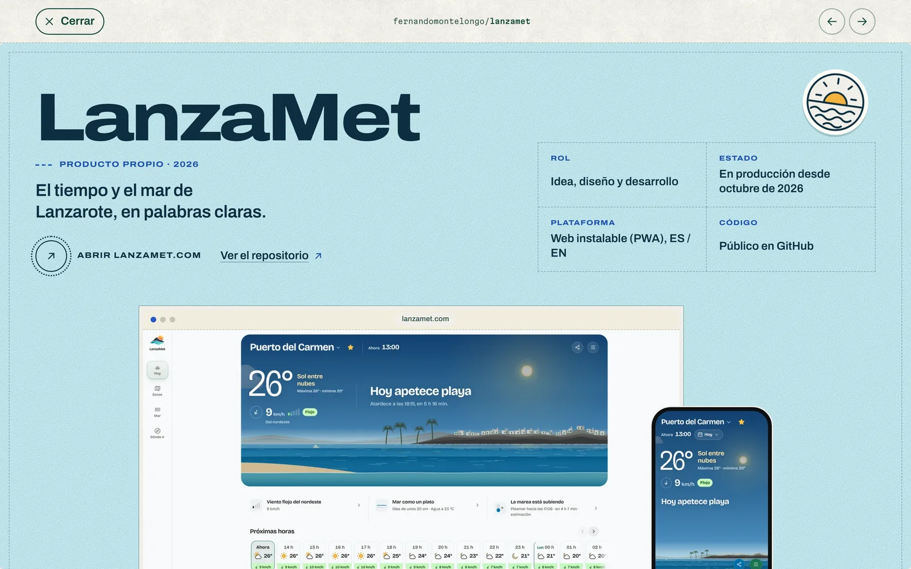
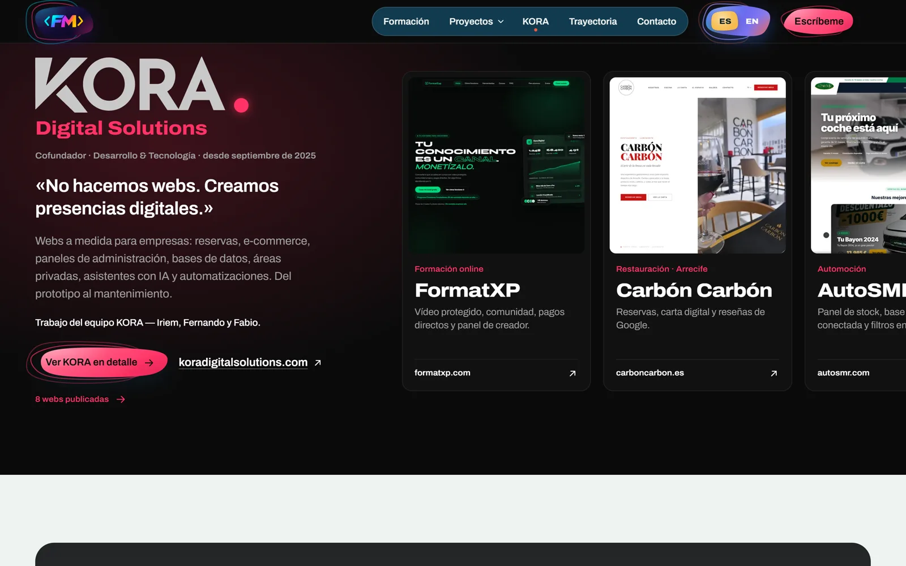
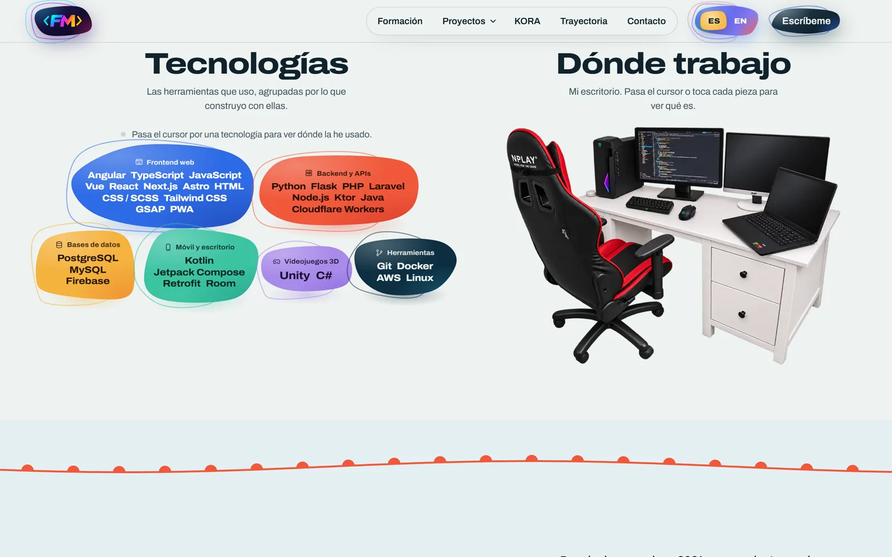
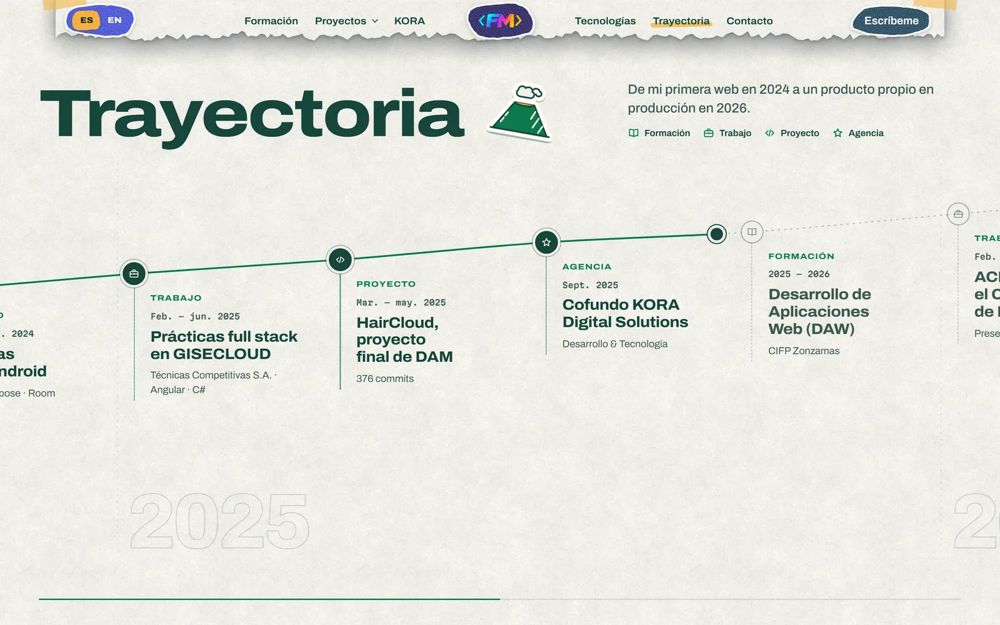
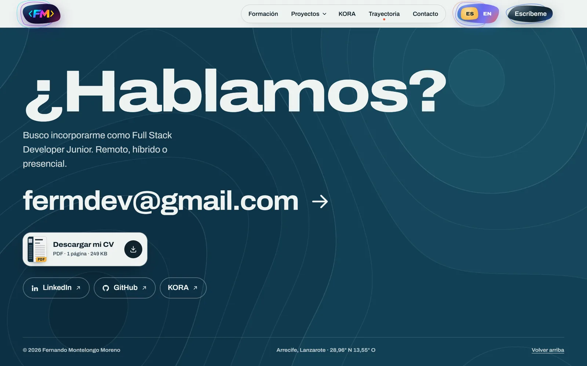
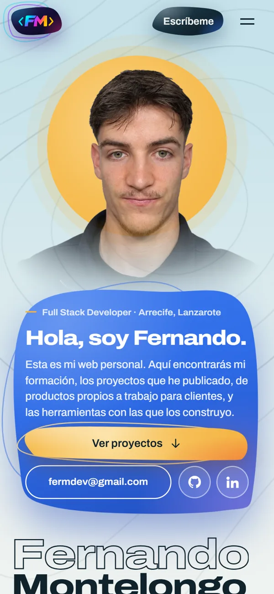

<div align="center">



# Portfolio

### Mi web personal, una forma visual de mostrar mi CV

**Proyecto personal · Diseño y desarrollo desde cero · Sin framework de UI**


[](#estado-del-proyecto)
[](https://fer-m.dev)
[](https://github.com/fmoorenoo/Portfolio-Web)

**[Visitar fer-m.dev](https://fer-m.dev)**

</div>

---

<div align="center">
  
</div>

## Sobre el proyecto

Es mi **portfolio personal**, publicado en **[fer-m.dev](https://fer-m.dev)**. 

Reúne mi formación, los proyectos que he publicado (de productos propios a trabajo para clientes y para una administración pública), mi trabajo en **KORA**, las tecnologías que uso, mi trayectoria y la forma de contactarme. Todo el contenido es verificable: no hay métricas, clientes ni tecnologías inventadas.

## Funcionalidades

- **Campo de presión en WebGL2:** isobaras y bandas de color animadas que se mueven con el scroll, con alternativa en CSS si no hay WebGL.
- **Ventanas de proyecto:** LanzaMet, ACESLAN, KORA y HairCloud se abren desde su tarjeta con capturas reales, cómo están hechos y enlaces. Cada una tiene su propia dirección (`/proyectos/lanzamet/`…).
- **Visor de capturas:** cualquier captura se abre a pantalla completa desde su miniatura.
- **Tramos horizontales:** KORA, con la vista previa de sus webs, y la trayectoria 2021–2026 avanzan en horizontal mientras se hace scroll.
- **Retrato interactivo:** en escritorio, un selector cambia lo que pasa al pasar el cursor por la foto: rayos X, colores invertidos o una mirada que sigue al cursor.
- **Mi escritorio:** una foto de mi puesto de trabajo en la que cada pieza se puede señalar para ver qué es.
- **Bilingüe:** español e inglés, con selector de idioma.
- **Accesible:** navegación con teclado en las ventanas (Esc, ← y →) y alternativa sin animaciones para quien prefiere movimiento reducido.

## Tecnologías

| Área | Tecnologías |
| --- | --- |
| **Base** | TypeScript · HTML · CSS, sin framework de UI |
| **Build** | Vite |
| **Animación** | GSAP: ScrollTrigger, ScrollSmoother, SplitText y DrawSVG |
| **Gráficos** | WebGL2 (campo de presión en un único triángulo) |
| **Imágenes** | sharp para generar las variantes en WebP |
| **Herramientas** | Playwright para capturas y medidas de rendimiento |
| **Publicación** | Cloudflare Workers con assets estáticos · dominio propio |

## Arquitectura

```text
Portfolio-Web/
├── index.html          # Toda la página en español
├── src/
│   ├── main.ts         # Arranque, scroll y animaciones por sección
│   ├── field.ts        # Campo de presión en WebGL2
│   ├── blobs.ts        # Formas irregulares de la portada y las tecnologías
│   ├── windows.ts      # Ventanas de proyecto y sus rutas
│   ├── content.ts      # Contenido de cada proyecto (ES / EN)
│   ├── details.ts      # Detalles interactivos de cada sección
│   ├── lightbox.ts     # Visor de capturas a pantalla completa
│   ├── i18n.ts         # Textos en inglés
│   └── styles.css      # Estilos y tokens de diseño
├── public/img/         # Imágenes optimizadas que sirve la web
├── scripts/            # Generación de imágenes, capturas y medidas de rendimiento
└── docs/               # Imágenes de este README y notas de capturas
```

### Decisiones técnicas

- **Rendimiento:** solo se animan transformaciones y opacidad, y las animaciones en bucle se pausan fuera de pantalla. Medido con `scripts/perf.mjs`: 16,7 ms por fotograma (p90) en escritorio y en móvil. En un móvil medio simulado, el LCP bajó de ~5,5 s a ~2,7 s al crear los disparadores en tiempo libre.
- **Campo de presión:** bandas cada 4 hPa e isobaras cada 2 hPa a partir de seis centros, dibujadas solo mientras el lienzo es visible y con un fotograma fijo si se prefiere movimiento reducido.
- **Rutas en hosting estático:** en el build se copia `index.html` a la ruta de cada proyecto, así que cada ventana tiene su dirección sin necesidad de servidor.
- **Legibilidad:** el texto de lectura vive sobre fondos sólidos y las etiquetas sobre la carta van en píldoras de papel.

Producto y dirección de diseño: [`PRODUCT.md`](PRODUCT.md) y [`DESIGN.md`](DESIGN.md).

## Vista del proyecto

| Software hecho en Lanzarote | Proyectos |
| :---: | :---: |
|  |  |

| Ventana de proyecto | KORA |
| :---: | :---: |
|  |  |

| Tecnologías y escritorio | Trayectoria |
| :---: | :---: |
|  |  |

| Contacto | En el móvil |
| :---: | :---: |
|  |  |

## Instalación y ejecución

Requisitos: **Node** y npm.

```bash
git clone https://github.com/fmoorenoo/Portfolio-Web.git
cd Portfolio-Web
npm install

npm run dev     # http://127.0.0.1:5181
npm run build   # dist/, con una página por proyecto
```

En desarrollo, `?nosmooth` desactiva el scroll suave y `?nofield` el campo WebGL. Las imágenes se regeneran con los scripts de `scripts/` a partir de fuentes que no están en el repositorio. Cómo se hicieron las capturas de cada proyecto está en [`docs/CAPTURAS.md`](docs/CAPTURAS.md).

## Estado del proyecto

**Publicado en [fer-m.dev](https://fer-m.dev)** y en evolución: se actualiza a medida que publico nuevos proyectos.

## Autor

**Fernando Montelongo Moreno** · Full Stack Developer · DAM + DAW

[](https://github.com/fmoorenoo)
[](https://www.linkedin.com/in/fernando-montelongo/)
[](mailto:fermdev@gmail.com)

---
